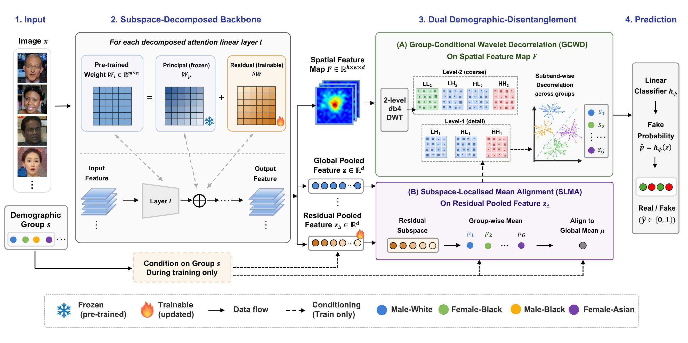

# FairReL: Deepfake Detection using Fairness-Aware Representation Learning

Official PyTorch implementation of the BMVC 2026 paper
**"FairReL: Deepfake Detection using Fairness-Aware Representation Learning"**
by Xiaoman Lu, Jiaqi Li, Shuntian Zheng, Huiping Chen and Yu Guan
(University of Warwick, University of Birmingham).

<p align="center">
  
</p>

FairReL targets two sources of demographic unfairness in deepfake detectors:

- **GCWD (Group-Conditional Wavelet Decorrelation)** decomposes the spatial
  feature map into wavelet sub-bands and suppresses subgroup-imbalanced
  spectral structure before pooling, while preserving local forgery evidence.
- **SLMA (Subspace-Localised Mean Alignment)** aligns subgroup means within
  each real/fake class in the *fine-tuning residual* representation of an
  SVD-decomposed CLIP backbone, removing adaptation-induced demographic
  shifts without touching the frozen visual prior.

Demographic labels are required only during training; at inference FairReL is
a plain backbone + classifier with no extra overhead.

## Installation

```bash
conda create -n fairrel python=3.10 -y
conda activate fairrel
pip install -r requirements.txt
```

Verify the SVD split (frozen rank 1023 / trainable rank 1 for CLIP ViT-L/14
with the paper default r = 1):

```bash
python scripts/verify_rank.py
```

Run the unit tests (no dataset or CLIP download needed):

```bash
python tests/test_fairrel.py
```

## Data preparation

See [docs/DATASETS.md](docs/DATASETS.md) for downloading FF++ (c23), Celeb-DF,
DFD and DFDC, attaching the demographic annotations, and building the CSV
files consumed by the training and evaluation scripts.

## Training

Train on FF++ (c23) with the paper's default configuration
(CLIP ViT-L/14, r = 1, lambda_orth = 0.1, lambda_G = lambda_S = 0.5):

```bash
python train.py --config configs/fairrel_clip_vitl14.yaml \
    --train-csv data/ffpp_train.csv --val-csv data/ffpp_val.csv \
    --data-root /path/to/images --output-dir outputs/fairrel
```

Model selection uses only the FF++ validation split (combined AUC and
FPR-disparity score at the TPR = 0.90 operating point); target-domain data is
never used for selection. The full hyperparameter tuning protocol, including
every grid swept in the paper, is documented in
[docs/TUNING.md](docs/TUNING.md).

## Evaluation

Evaluate under the paper's fixed-threshold protocol (threshold pinned on the
FF++ validation split at source-domain TPR = 0.90, reused on every dataset):

```bash
python test.py --config configs/fairrel_clip_vitl14.yaml \
    --checkpoint outputs/fairrel/best.pt \
    --val-csv data/ffpp_val.csv --data-root /path/to/images \
    --test ffpp=data/ffpp_test.csv celebdf=data/celebdf_test.csv \
           dfd=data/dfd_test.csv dfdc=data/dfdc_test.csv
```

Reported metrics: AUC, group-averaged AUC, AUC gap, Equal FPR (F_FPR) and
Max Equalized Odds (F_MEO); definitions follow the supplementary material.

For deployment, `model.merge_for_inference()` folds the SVD decomposition
back into plain linear layers, so the shipped model has exactly the memory
and speed of the undecomposed backbone plus a linear classifier:

```python
import torch

from fairrel.models import FairReLDetector

model = FairReLDetector()
model.load_state_dict(torch.load("outputs/fairrel/best.pt")["model"])
model.merge_for_inference()  # identical predictions, no decomposition overhead
```

## Results

Cross-domain results after training on FF++ (c23), as reported in the paper
(mean over three seeds):

| Test set  | AUC   | AUC_avg | F_FPR ↓ | F_MEO ↓ |
|-----------|-------|---------|---------|---------|
| FF++      | 96.14 | 96.54   | 10.97   | 7.41    |
| Celeb-DF  | 80.64 | 81.26   | 10.12   | 7.03    |
| DFD       | 86.13 | 86.78   | 13.55   | 8.98    |
| DFDC      | 66.34 | 67.03   | 38.36   | 30.02   |

## Acknowledgements

The SVD principal/residual backbone decomposition follows
[Effort](https://arxiv.org/abs/2411.15633) ("Orthogonal Subspace Decomposition
for Generalizable AI-Generated Image Detection", Yan et al., ICML 2025), and
the evaluation protocol and demographic annotations follow
[PG-FDD](https://github.com/Purdue-M2/Fairness-Generalization) ("Preserving
Fairness Generalization in Deepfake Detection", Lin et al., CVPR 2024).
We thank the authors of both works.

## License

This project is released under the [MIT License](LICENSE).
